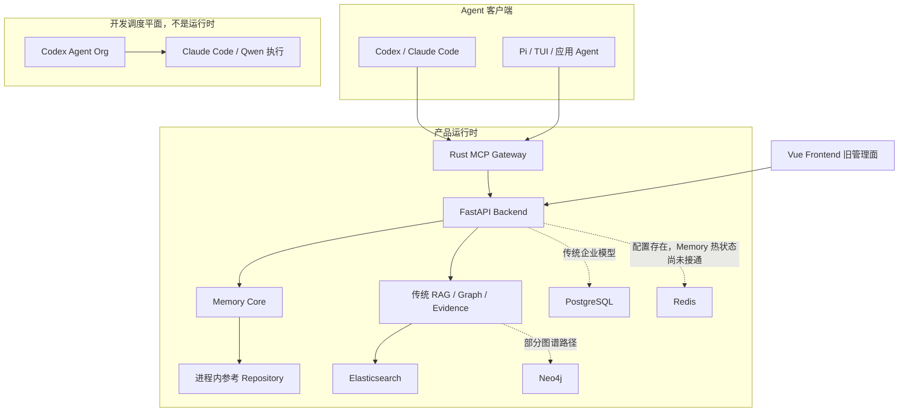
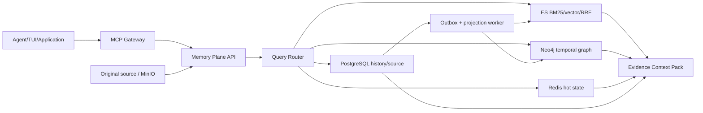

# 集成架构与数据流

## 当前系统

## 目标系统

## 集成边界

| 边界 | 当前负责人 | 不能越界的内容 |
|---|---|---|
| Agent → MCP | Agent Runtime / MCP | MCP 不负责 Agent 规划和设备动作 |
| MCP → Backend | Gateway | Gateway 不复制企业数据真源 |
| Backend → Memory Core | Backend | Memory 返回事实、状态、证据和拒答，不执行任务 |
| Memory Core → Stores | 持久化/投影 worker | PostgreSQL 是权威记录，ES/Neo4j/Redis 是投影或缓存 |
| Memory → Agent Plane | Agent Runtime | Agent 自己决定推理、计划、人工审批和调度 |
| Frontend → Backend | 旧管理面 | Frontend 不应成为 Memory Plane 必需依赖 |
| Codex Agent Org → Claude/Qwen | 开发控制平面 | 不得把开发调度状态当成无人机/企业 Agent 运行状态 |

## 故障与一致性策略

1. 权威记忆写入成功后，必须产生可重放的 Outbox 事件。
2. ES、Neo4j、Redis 投影失败时，查询要返回 freshness/projection 状态，而不是静默当作最新事实。
3. 删除、撤销和法律保留必须传播到所有投影，并保留审计事件。
4. 图谱关系和模型抽取结果只能作为候选或检索线索，经过证据与审核后才成为可发布事实。
5. 没有足够证据时，Memory 返回 `insufficient_evidence`，不生成猜测。
