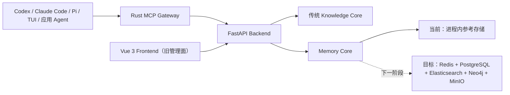

# esRAGPro 项目总览

> 文档日期：2026-07-22
> 扫描模式：Exhaustive Scan
> 当前判断：Agent Memory Plane Phase 2-A 验证阶段，尚未达到生产 GA

## 一句话定位

esRAGPro 正从“企业可信知识库 RAG”演进为“可被 Agent 调用的记忆基础设施”：保存实时状态、历史事实、企业知识、关系图谱和证据上下文，但不负责 Agent 推理、任务规划、设备控制或蜂群调度。

## 当前产品边界

| 范围 | 负责内容 | 当前状态 |
|---|---|---|
| 传统企业 RAG | 文档摄取、BM25 + 向量混合检索、RRF、来源引用、拒答 | 已有实现 |
| Memory Core | 观察、记忆合同、证据、审核、冲突、生命周期、Outbox、上下文包 | 领域代码和单测已具备 |
| Agent Memory Plane | `remember`、`query`、`create_context` 纵向链路 | Phase 2-A，参考存储 |
| Knowledge Graph | 实体、关系、子图、路径、声明验证接口 | Neo4j 服务存在，GraphRAG 查询仍不完整 |
| MCP Gateway | Rust rmcp 协议适配，stdio/HTTP，记忆和知识工具 | 可编译、测试通过；新记忆工具仍是进程内参考实现 |
| Agent Plane | 推理、计划、调度、人工审批、无人机动作 | 明确不属于本项目当前职责 |
| Frontend | 旧版文档、搜索、图谱、评测和 Agentic Chat 管理界面 | 仍保留，不是记忆核心依赖 |
| Codex Agent Org | Codex 调度 Claude Code/Qwen 等开发执行 | 开发控制平面，不是运行时产品 |

## 当前架构摘要



## 技术栈

| 部分 | 技术 | 证据 |
|---|---|---|
| Backend | Python 3.10+、FastAPI、Pydantic、SQLAlchemy、Alembic | `backend/pyproject.toml`、`backend/app/main.py` |
| 传统检索 | Elasticsearch 8.12、Sentence Transformers、BGE-M3、RRF | `backend/app/core/elasticsearch.py`、`backend/app/services/embedding.py` |
| 数据与图谱 | PostgreSQL、Redis、Neo4j、MinIO/Blob 抽象 | `docker-compose.yml`、`backend/app/db`、`backend/app/memory_core/repositories` |
| Frontend | Vue 3、Vite 5、Pinia、Vue Router、Element Plus、vis-network | `frontend/package.json` |
| MCP | Rust 2021、rmcp 1、Axum 0.8、Tokio、Reqwest、Serde | `esragpro-mcp/Cargo.toml` |
| 开发调度 | Node.js 18+、JSONL 事件、Codex/Claude Code adapters | `.agent-team/control-plane/package.json` |
| 部署 | Docker Compose、Nginx、Windows Docker Desktop/WSL2 | `docker-compose.yml`、`docker-compose.secure.yml` |

## 已验证事实

- Python 新 Memory Plane 定向测试：57 passed。
- Rust MCP `cargo test --locked --all-targets`：140 passed，1 failed；失败项为既有的 `test_session_ttl` 零毫秒边界断言。
- Rust `cargo fmt --check` 通过；`cargo clippy -- -D warnings` 仍被 25 个既有 dead-code 警告阻断。
- `memory.remember -> memory.query -> memory.create_context` 在参考实现中可以闭环。
- Memory 专用 PostgreSQL、ES、Neo4j、Redis、MinIO 适配器仍包含 mock/stub 行为，尚未成为真实生产链路。
- 100ms 目标尚未有 P50/P95/P99 基准；“0 幻觉”当前只能实现证据不足时拒答，不能宣称生成模型绝对零幻觉。

## 当前最大风险

1. 历史文档中的“Phase 完成”容易被误读为生产化完成；应以实际适配器和端到端测试为准。
2. 新 MCP 记忆工具与 FastAPI 的参考存储尚未通过 HTTP 接通，多进程/重启后数据不持久。
3. 传统企业授权链和新的无权限记忆合同并存，必须保持边界，不能把数据维度误当成 ACL。
4. KnowledgeGraphService 有 Neo4j 交互能力，但 GraphRAG 的图查询路径仍有降级实现。
5. 当前提交只代表 Phase 2-A 参考实现，不能把本地验证状态当成已发布版本。

## 下一阶段验收目标

完成一个真实存储的端到端闭环：

```text
Agent/MCP remember
  -> PostgreSQL 权威事件/记忆记录
  -> Elasticsearch 混合检索投影
  -> Neo4j 关系投影
  -> Redis 热状态/会话缓存
  -> query 自动路由与证据包
  -> context 返回可追溯上下文
```

该闭环通过后，才进入实时流、性能基准、MCP 客户端兼容性和生产发布门禁。
