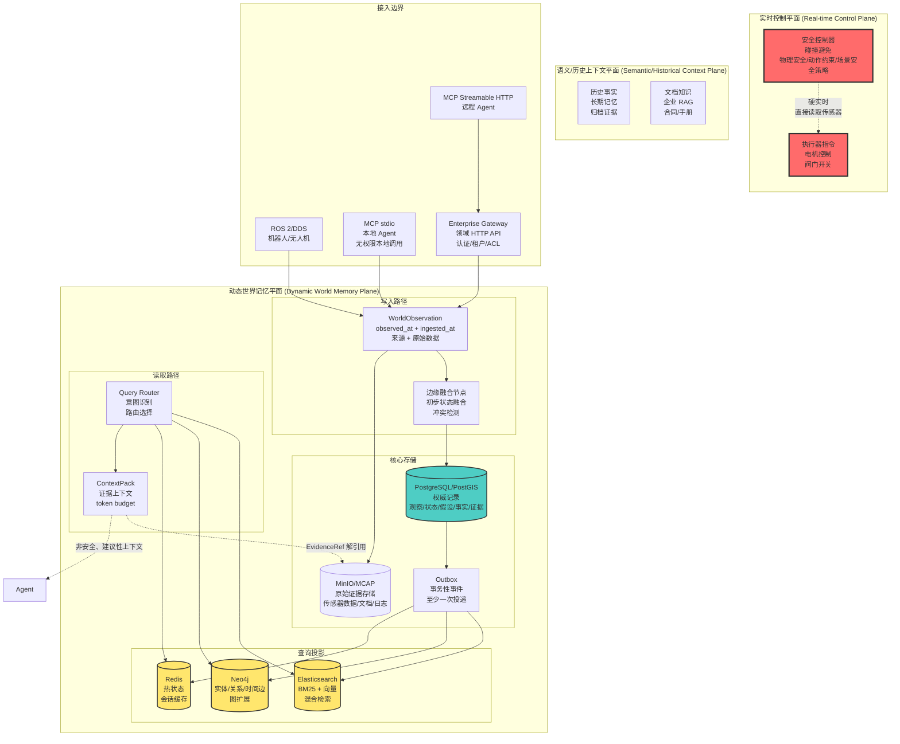

# 动态世界记忆架构

> 文档日期：2026-07-23
> 最后更新：2026-07-31 — 新增 P7 合同内核章节
> 状态：长期架构方向，当前处于 Phase 2-A 参考存储阶段

## 总体架构



## 三层平面隔离

### 1. 实时控制平面 (Real-time Control Plane)

**职责**: 碰撞避免、物理安全、动作约束、场景特定安全策略、硬实时控制

**特征**:
- 延迟要求: < 10ms（目标，尚未完成基准验证）
- 不经过 LLM、RAG、Elasticsearch 或 Neo4j
- 直接从传感器读取，直接输出控制指令
- 独立部署，与记忆平面物理隔离

**技术边界**:
- 安全控制器: 场景特定实现，不与记忆平面共享代码
- 执行器: 电机、阀门、开关等物理设备
- 通信: CAN bus、EtherCAT 等工业实时协议

### 2. 动态世界记忆平面 (Dynamic World Memory Plane)

**职责**: 记录观察、融合状态、管理假设、验证事实、组织证据、提供上下文

**特征**:
- 延迟要求: 热状态 < 100ms，混合检索 < 2s（目标，尚未完成基准验证）
- 事件驱动写入，支持双时间和可重放
- 提供证据约束的上下文包给 Agent
- Memory Plane 仅向 Agent/Planner 提供非安全、建议性的上下文；不得向安全控制器提供硬实时数据路径

**核心组件**:
- PostgreSQL/PostGIS: 权威记录
- Outbox: 事务性事件
- Redis: 热状态和会话缓存
- Elasticsearch: 混合检索
- Neo4j: 图扩展
- MinIO/MCAP: 原始证据存储

### 3. 语义/历史上下文平面 (Semantic/Historical Context Plane)

**职责**: 长期记忆、归档证据、文档知识、企业 RAG

**特征**:
- 延迟要求: < 5s（目标，尚未完成基准验证）
- 以文档和事实为主，变化频率低
- 支持 BM25 + 向量混合检索
- 与动态世界记忆共享检索基础设施

**技术边界**:
- 历史事实: 已验证的长期记忆
- 文档知识: 企业文档、合同、手册
- 归档证据: 历史事件和传感器数据

## 数据模型

### 核心对象

#### WorldObservation

```json
{
  "id": "uuidv7",
  "observed_at": "2026-07-23T10:00:00.000Z",
  "ingested_at": "2026-07-23T10:00:00.123Z",
  "source_type": "sensor|document|tool|user",
  "source_id": "sensor-001",
  "source_version": "1.0.0",
  "content": "温度读数 45.2°C",
  "raw_data_ref": "minio://raw/2026/07/23/sensor-001.json",
  "confidence": 0.95,
  "metadata": {}
}
```

**最小字段**:
- `id`: 唯一标识
- `observed_at`: 世界时间（传感器时钟）
- `ingested_at`: 系统时间（接收时间）
- `source_type`: 来源类型
- `source_id`: 来源标识
- `content`: 观察内容
- `raw_data_ref`: 原始数据引用

#### WorldState

```json
{
  "id": "uuidv7",
  "state_type": "location|temperature|status",
  "valid_from": "2026-07-23T10:00:00.000Z",
  "valid_to": "2026-07-23T10:05:00.000Z",
  "value": {"lat": 31.2304, "lon": 121.4737},
  "observation_ids": ["obs-001", "obs-002"],
  "fusion_version": "1.0.0",
  "projection_version": "1"
}
```

**最小字段**:
- `id`: 唯一标识
- `state_type`: 状态类型
- `valid_from`: 有效开始时间
- `valid_to`: 有效结束时间
- `value`: 状态值
- `observation_ids`: 支撑观察 ID 列表
- `fusion_version`: 融合算法版本
- `projection_version`: 投影版本

#### Hypothesis

```json
{
  "id": "uuidv7",
  "content": "设备 A 可能过热",
  "confidence": 0.6,
  "evidence_ids": ["ev-001", "ev-002"],
  "contradicts": ["fact-001"],
  "status": "pending|verified|refuted",
  "created_at": "2026-07-23T10:00:00.000Z"
}
```

**最小字段**:
- `id`: 唯一标识
- `content`: 假设内容
- `confidence`: 置信度
- `evidence_ids`: 证据 ID 列表
- `contradicts`: 矛盾事实 ID 列表
- `status`: 状态

#### VerifiedFact

```json
{
  "id": "uuidv7",
  "content": "设备 A 温度 45.2°C",
  "evidence_ids": ["ev-001", "ev-002", "ev-003"],
  "verified_at": "2026-07-23T10:01:00.000Z",
  "supersedes": ["fact-000"],
  "valid_from": "2026-07-23T10:00:00.000Z",
  "valid_to": null,
  "revoked_at": null
}
```

**最小字段**:
- `id`: 唯一标识
- `content`: 事实内容
- `evidence_ids`: 证据 ID 列表
- `verified_at`: 验证时间
- `supersedes`: 取代的事实 ID
- `valid_from`: 有效开始时间
- `valid_to`: 有效结束时间（null 表示当前有效）

#### EvidenceRef

```json
{
  "id": "uuidv7",
  "source_type": "sensor|document|tool|user",
  "source_id": "sensor-001",
  "source_version": "1.0.0",
  "content_hash": "sha256:...",
  "storage_ref": "minio://evidence/2026/07/23/ev-001.json",
  "created_at": "2026-07-23T10:00:00.000Z"
}
```

**最小字段**:
- `id`: 唯一标识
- `source_type`: 来源类型
- `source_id`: 来源标识
- `source_version`: 来源版本
- `content_hash`: 内容哈希
- `storage_ref`: 存储引用

#### ContextPack

```json
{
  "id": "uuidv7",
  "query_id": "q-001",
  "token_budget": 4096,
  "items": [
    {"type": "fact", "id": "fact-001", "content": "..."},
    {"type": "observation", "id": "obs-001", "content": "..."},
    {"type": "evidence", "id": "ev-001", "storage_ref": "..."}
  ],
  "created_at": "2026-07-23T10:02:00.000Z"
}
```

**最小字段**:
- `id`: 唯一标识
- `query_id`: 查询 ID
- `token_budget`: token 预算
- `items`: 上下文项列表

### 时间字段语义

| 字段 | 语义 | 用途 |
|---|---|---|
| `observed_at` | 世界时间（传感器时钟） | 区分传感器时钟漂移 |
| `ingested_at` | 系统时间（接收时间） | 区分系统处理延迟 |
| `valid_from` | 有效开始时间 | 时间有效性检查 |
| `valid_to` | 有效结束时间 | 时间有效性检查（null 表示当前有效） |
| `supersedes` | 取代的事实 ID | 事实更新链 |
| `contradicts` | 矛盾的事实/假设 ID | 冲突检测 |
| `source_version` | 来源版本 | 数据溯源 |
| `projection_version` | 投影版本 | 投影一致性检查 |

## 存储职责

| 存储 | 职责 | 不做什么 |
|---|---|---|
| **PostgreSQL/PostGIS** | 权威记录：观察、状态、假设、事实、证据、版本、审计 | 不做检索、不做图查询 |
| **Outbox** | 事务性事件：至少一次投递、幂等、可重放；记录本身与权威写入同事务持久化 | 不作为业务查询真源 |
| **Redis** | 热状态：会话缓存、短期上下文、查询缓存 | 不做长期存储 |
| **Elasticsearch** | 混合检索：BM25 + 向量 + metadata filter + RRF | 不做权威记录 |
| **Neo4j** | 图扩展：实体、关系、时间边、路径查询 | 不做权威记录 |
| **MinIO/MCAP** | 原始证据：传感器数据、文档、日志 | 不做检索 |

## 接入边界

| 接入方式 | 场景 | 延迟目标 |
|---|---|---|
| **ROS 2/DDS** | 机器人、无人机、工业设备 | < 100ms |
| **MCP stdio** | 本地 Agent（Codex、Claude Code、Pi），无权限本地调用 | < 500ms |
| **MCP Streamable HTTP** | 远程 Agent、企业集成，经 Enterprise Gateway 认证 | < 2s |
| **领域 HTTP API** | 企业应用、Web 前端，经 Enterprise Gateway 认证 | < 2s |

所有延迟数字均为**尚未完成基准验证的目标**，不构成当前性能承诺。

**硬实时控制不得经过 LLM、RAG、Elasticsearch 或 Neo4j。** 安全控制器直接从传感器读取，不通过记忆平面。Memory Plane 仅向 Agent/Planner 提供非安全、建议性的上下文。

## 分层延迟目标

| 路径 | 延迟目标 | 说明 |
|---|---|---|
| **热状态** | < 100ms | Redis 直接读取，不含 LLM |
| **持久化** | < 500ms | PostgreSQL 写入确认 |
| **混合检索** | < 2s | Elasticsearch + Neo4j + RRF |
| **图扩展** | < 3s | Neo4j 多跳路径查询 |

**以上所有延迟目标均为尚未完成基准验证的目标值，不构成当前性能承诺。** 关键: 以上延迟目标不含 LLM 生成时间。LLM 生成是独立步骤，不在记忆平面延迟预算内。

## Enterprise Gateway 认证边界

Enterprise Gateway 的认证（OAuth/OIDC、API Key）属于**网络信任边界**，不进入无权限 Memory Core 的领域语义。无权限 Memory Core 的公开领域合同不要求 `PrincipalContext`、认证字段或领域授权。

- **Enterprise Gateway / Remote Adapter** 负责验证身份、管理租户和执行访问策略
- 企业远程适配器必须在检索前把租户/ACL 约束编译为 PostgreSQL/Elasticsearch/Neo4j 的存储或查询过滤，不能只做 Gateway 后置过滤，也不能让无权限 Memory Core 理解认证凭证
- **Memory Core** 本身只接收领域输入，不要求已认证主体。企业路径在 Gateway 层已完成认证和访问约束编译后才调用 Core；Core 不处理原始认证凭证，不执行领域授权
- **本地 MCP stdio** 和无权限 Memory Core 不要求 OAuth/Principal/scope 等企业级字段
- ACL 在 Gateway/adapter 层编译到存储查询，Memory Core 保持无权限的领域语义

## 与现有架构的关系

- [ADR 0001: 系统记录与投影](./adr/0001-system-of-record-and-projections.md)：PostgreSQL 是权威记录，ES/Neo4j 是查询投影
- [ADR 0002: Enterprise 与 Edge 交付形态](./adr/0002-enterprise-and-edge-delivery-shapes.md)：Enterprise 优先，Edge 后续
- [ADR 0003: 身份、ACL 和信任边界](./adr/0003-identity-acl-and-trust-boundary.md)：认证在网络边界，Memory Core 不处理凭证
- [ADR 0005: 动态世界记忆边界](./adr/0005-dynamic-world-memory-boundary.md)：职责边界和设计原则
- [Memory Plane 交付计划](./memory-plane-delivery-plan.md)：分阶段开发路线

## 参考链接

以下公开资料提供了相关技术参考，不得声称这些外部产品的结果已在 esRAGPro 中复现：

- [ROS 2 QoS](https://docs.ros.org/en/humble/Concepts/Intermediate/About-Quality-of-Service-Settings.html)
- [MCAP](https://mcap.dev/guides)
- [MCP Architecture](https://modelcontextprotocol.io/docs/learn/architecture)
- [Elasticsearch Hybrid Search](https://www.elastic.co/docs/solutions/search/hybrid-search)
- [Graphiti](https://help.getzep.com/graphiti/getting-started/welcome)

---

## P7 — 动态世界记忆合同内核

> 文档日期：2026-07-31
> 状态：合同内核已实现 (`app.memory_core.world_memory`)，持久化 / API / MCP 接线延迟到后续运行。

### 目的

P7 合同内核是动态世界记忆平面的**纯领域层**。它建模了原始观察、融合状态、假设和已验证事实之间的**明确区分**，并为每个状态转换保留完整的审计轨迹。

它是一个**纯领域内核**：冻结数据类、纯转换函数、无 I/O、无持久化、无授权、无代理规划或设备控制。

### 核心区分

```text
WorldObservation ──► WorldState              (fusion)
WorldObservation ──► Hypothesis              (abduction)
Hypothesis        ──► VerifiedFact           (verification)
VerifiedFact      ──► supersedes/contradicts prior fact or hypothesis
```

### 实现状态

| 项目 | 状态 |
|------|------|
| 合同内核 | ✅ 已实现 (`app.memory_core.world_memory`) |
| 聚焦测试 | ✅ 70 测试通过 |
| 持久化 / 存储库 | 🔲 延迟（后续运行） |
| API / MCP 接线 | 🔲 延迟（后续运行） |

### 领域对象

#### WorldObservation

不可变的世界观察，记录单一时间点的世界状态。

| 字段 | 类型 | 用途 |
|------|------|------|
| `id` | `UUID` | 唯一标识 |
| `content` | `str` | 观察内容 |
| `observed_at` | `datetime` | **世界时间** — 现象发生时间 |
| `ingested_at` | `datetime` | **系统时间** — 平台接收时间 |
| `source` | `str` | 稳定的来源标识（传感器、文档等） |
| `version` | `int` | 架构演进版本 |
| `raw_evidence_ref` | `Optional[str]` | 原始证据存储引用 |
| `sensor_id` | `Optional[str]` | 观察来源的传感器/代理 |

**关键不变量**: `observed_at` 和 `ingested_at` **相互独立**。它们之间的差值（`clock_skew()`）是可观察的，不会被静默修正。这保留了传感器时钟漂移作为诊断信息。

#### ValidityInterval

半开区间 `[start, end)` 用于状态有效性。

- `end = None` → 开放结束（仍然有效）
- `start > end` → 在构造时**被拒绝**，抛出 `InvalidValidityIntervalError`
- 传感器时钟漂移通过 `WorldObservation.clock_skew()` 观察，与 `ValidityInterval` 无关

#### WorldState

在 `ValidityInterval` 内有效的融合世界快照。

| 字段 | 类型 | 用途 |
|------|------|------|
| `observation_ids` | `Tuple[UUID, ...]` | 贡献观察 |
| `fusion_version` | `int` | 算法版本（用于重融合检测） |
| `projection_version` | `int` | 投影版本（用于重投影检测） |
| `supersedes` | `Tuple[UUID, ...]` | 此状态替代的先前状态 |
| `contradicts` | `Tuple[UUID, ...]` | 与此状态冲突的先前状态 |

#### Hypothesis

从观察中派生的不可变假设。生命周期：

```text
PENDING ──► VERIFIED   (via verify_hypothesis, requires evidence)
PENDING ──► REFUTED    (via refute_hypothesis, requires evidence)
```

每次转换在 `transition_record` 审计轨迹中记录 `TransitionRecord`，捕获证据 ID、原因和 supersedes/contradicts 链接。

#### VerifiedFact

从已验证假设提升的不可变事实。

| 字段 | 类型 | 用途 |
|------|------|------|
| `hypothesis_id` | `UUID` | 源假设 |
| `evidence_ids` | `Tuple[UUID, ...]` | 验证此事实的证据 |
| `verified_at` | `datetime` | 提升时间戳 |
| `fusion_version` | `int` | 提升时的融合版本 |
| `revocation` | `Optional[RevocationRecord]` | 如果被撤销则设置 |

**撤销**是显式的：`revoke_fact(fact, evidence_ids, reason=...)` 返回带有 `RevocationRecord` 的新事实。原始事实永远不会被修改。

### 纯转换函数

| 函数 | 输入 | 输出 | 前置条件 |
|------|------|------|----------|
| `verify_hypothesis(h, evidence_ids, ...)` | 待处理假设 + 证据 | `(VerifiedFact, updated_hypothesis)` | 状态必须为 PENDING；证据非空 |
| `refute_hypothesis(h, evidence_ids, ...)` | 待处理假设 + 证据 | 更新后的假设（REFUTED） | 状态必须为 PENDING；证据非空 |
| `revoke_fact(f, evidence_ids, ...)` | 已验证事实 + 证据 | 更新后的事实（已撤销） | 未被撤销；证据非空 |
| `fuse_world_state(obs, content, validity, ...)` | 观察 + 内容 + 区间 | WorldState | 观察非空；有效性区间在构造时已验证 |

所有函数都是**纯的**：它们返回新对象，从不修改输入。

### 异常

| 异常 | 何时抛出 |
|------|----------|
| `InvalidTransitionError` | 从当前状态不允许转换 |
| `MissingEvidenceError` | 转换需要证据但未提供 |
| `InvalidValidityIntervalError` | `ValidityInterval` 构造时发现 `start > end` |

### WorldContextPack

类型化、预算化的世界记忆项包，用于 LLM 或代理。

```python
WorldContextPack(
    query_id=UUID,
    items=(WorldContextItem, ...),
    token_budget=4000,
    token_used=0,
)
```

每个 `WorldContextItem` 携带：
- `kind`: `OBSERVATION | STATE | HYPOTHESIS | FACT`
- `id`: UUID
- `content`: str
- `evidence_ids`: Tuple[UUID, ...]

包是**被动的**：它携带用于上下文构建的数据，但不能执行计划、命令或设备操作。

### 设计约束

1. **冻结数据类** — 每个对象在构造后不可变
2. **朴素 UTC** — 所有时间戳归一化为朴素 UTC，与现有 `memory_core` 约定一致
3. **无授权** — 无主体、租户、范围或可见性字段
4. **无代理操作** — 模块中任何地方都没有 `plan()`、`execute()`、`dispatch()`、`command()` 或 `control_device()` 方法
5. **显式证据** — 每个状态转换需要显式证据 ID
6. **审计轨迹** — 每次转换记录 `TransitionRecord`，包含证据、原因和 supersedes/contradicts 链接
7. **可观察性优于沉默** — 传感器时钟漂移、无效区间和矛盾被保留为可观察数据，不会被静默修正

### 本次运行的范围外

- 持久化（存储库端口、适配器、PostgreSQL/Redis/ES 存储）
- API 端点和 MCP 接线
- 授权和 ACL 行为
- 代理规划、调度、设备控制或集群执行
- 数据库迁移

### 文件清单

| 文件 | 用途 |
|------|------|
| `backend/app/memory_core/world_memory.py` | 合同内核实现 |
| `backend/tests/unit/test_world_memory.py` | 70 项聚焦单元测试 |
| `docs/world-memory-architecture.md` | 本文档 |
