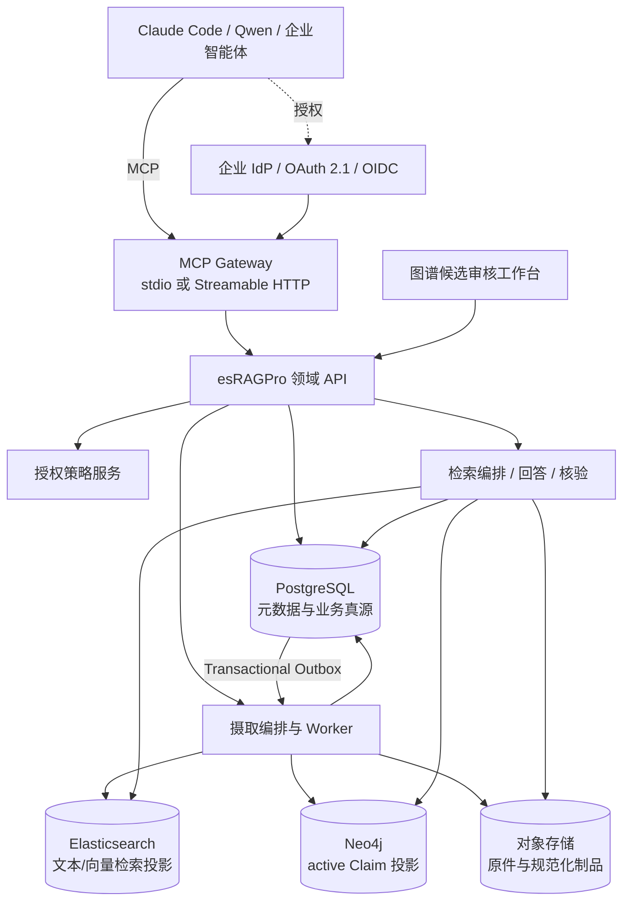
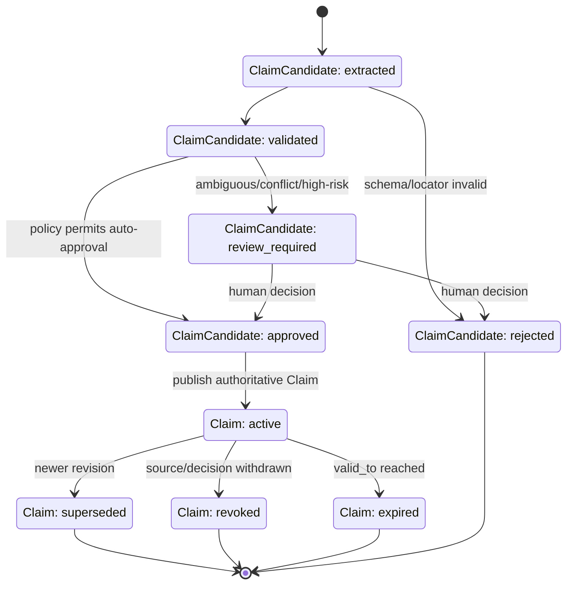

# esRAGPro MCP 企业架构设计

> 状态：已确认的实施基线  
> 文档版本：1.0  
> 适用协议：MCP 2025-11-25  
> 当前交付目标：Enterprise Edition；Local Edge Edition 为后续兼容实现

## 1. 架构结论

esRAGPro MCP 不是另一套知识库，也不复制 Elasticsearch、权限、文档版本和知识图谱。Enterprise Edition 的 MCP Server 是一个**薄协议与安全网关**：把 MCP 的 Tools、Resources、Prompts 映射到 esRAGPro 领域 API，并在进入领域服务之前完成身份解析、授权、限流、审计和输出裁剪。

以下决策是实现约束，而不是建议：

| 决策 | 结论 |
|---|---|
| 产品形态 | 一个知识核心，两种交付形态：Enterprise 与后续 Local Edge |
| Enterprise 数据面 | PostgreSQL/对象存储是真源；Elasticsearch 与 Neo4j 是可重建投影 |
| MCP 职责 | 协议适配、安全上下文、Schema 校验、结果包装；不承载第二套领域逻辑 |
| 检索 | BM25 与 dense 并行，图检索按查询意图触发，RRF 后交叉编码重排 |
| 图谱可信性 | LLM 只产生 ClaimCandidate；只有获批候选发布出的 `active` Claim 才能进入 Neo4j |
| 权限 | 在每条召回路径执行 ACL 预过滤；返回前再次校验仅作纵深防御 |
| 远程协议 | Streamable HTTP；不新建旧版 HTTP+SSE 实现 |
| 本地协议 | stdio；stdout 只能发送 MCP JSON-RPC，日志只能写 stderr |
| 写操作 | 从默认工具集隔离，按 scope 开启并要求客户端进行人类确认 |

### 1.1 范围与非目标

Enterprise V1 包含多租户、知识库/文档 ACL、版本化摄取、证据检索、审核后的知识图谱、带证据回答、MCP 远程接入和审计。它不包含第二套 LanceDB/SQLite 企业数据面，不允许远程客户端传服务器文件路径，不把 LLM 输出直接认定为事实，也不以固定的延迟或幻觉率数字作为未经基准验证的承诺。

Local Edge 将来可使用 Rust 与嵌入式存储，但必须复用本文件定义的领域契约、稳定 ID、证据模型、MCP Schema 和评测集。Local Edge 的单用户假设不能反向削弱 Enterprise 的租户、ACL 和审计边界。

## 2. 系统上下文与容器



### 2.1 模块职责

| 模块 | 必须负责 | 明确禁止 |
|---|---|---|
| MCP Gateway | MCP 生命周期、传输、Schema、PrincipalContext、scope、限流、审计关联、结果与 Resource Link 包装 | 自建知识库、绕过领域 API 直写 ES/Neo4j、信任工具参数中的身份 |
| 身份与授权 | 校验 token、构造 PrincipalContext、编译 AccessPredicate、执行租户/KB/文档/分类策略 | 接受客户端自报角色或租户、使用生成模型决定权限 |
| 文档领域服务 | 文档逻辑身份、不可变版本、ACL、状态、删除与保留策略 | 把 ES 文档当作真源 |
| 摄取编排 | 对象校验、解析、分块、嵌入、投影、重试、幂等、状态机 | 在远程模式读取任意客户端路径 |
| 检索编排 | 查询分类、并行召回、融合、重排、证据包、降级与 no-hit | 先全库检索再做权限后过滤 |
| 图谱治理 | 候选抽取、实体消歧、规则校验、冲突检测、人工审核、时态与版本 | 把抽取置信度等同事实真实性 |
| 回答与核验 | 仅基于证据包回答、声明级核验、拒答、引用 | 使用图路径或模型常识补足无证据结论 |
| 投影器 | 消费 outbox，幂等写 ES/Neo4j，维护水位和对账 | 反向成为业务数据写入口 |

## 3. 信任边界与请求身份

系统存在四个信任边界：客户端与 Gateway、Gateway 与领域 API、真源与异步投影、企业域与外部模型服务。用户问题、上传文档、文档内指令、MCP Tool 参数、LLM 输出和第三方模型响应全部是不可信输入。

### 3.1 PrincipalContext

Gateway 必须从已验证凭据构造以下上下文，并通过受认证的内部通道传给领域 API。工具参数不得包含或覆盖这些字段，日志不得记录原始 token。

```json
{
  "context_version": 1,
  "request_id": "uuidv7",
  "trace_id": "w3c-trace-id",
  "tenant_id": "uuidv7",
  "subject_id": "stable-subject-id",
  "subject_type": "user|service",
  "client_id": "oauth-client-id",
  "authn": {
    "issuer": "https://idp.example.com",
    "audience": "https://mcp.example.com/mcp",
    "method": "oauth|workload|local-stdio",
    "auth_time": "RFC3339"
  },
  "authorization": {
    "scopes": ["knowledge:read"],
    "roles": ["reader"],
    "group_ids": ["stable-group-id"],
    "knowledge_base_ids": ["uuidv7"],
    "clearance": "internal",
    "policy_version": "policy-version",
    "authorization_revision": 42,
    "authorization_fingerprint": "sha256-of-effective-grants",
    "access_partition_ids": ["u:stable-subject-id", "g:stable-group-id", "r:reader"]
  },
  "delegation": {
    "on_behalf_of": "stable-subject-id",
    "chain": ["oauth-client-id"]
  }
}
```

规则如下：

1. Streamable HTTP 使用面向该 MCP Resource Server 的访问令牌，验证 issuer、signature、expiry、audience 与 scope；禁止 token passthrough。
2. stdio 不套用 HTTP OAuth 流程；凭据来自受控环境、系统密钥链或企业启动器，并映射为 `local-stdio` PrincipalContext。
3. `tenant_id`、角色、组和权限集合只来自服务端身份/策略系统。请求参数中的 KB 列表只能进一步缩小范围。
4. Gateway 向下游传短期签名上下文或工作负载身份；领域 API 必须验证签名、有效期和 audience。
5. 缓存键、游标、异步任务和审计事件必须绑定 `tenant_id` 与授权 `fingerprint`。
6. `/.well-known/oauth-protected-resource` 是未认证、可缓存的资源级 metadata，固定公布 V1 八个支持 Scope 的并集，不按 token/tenant 动态变化；它不授予权限，profile 按服务端开关、租户策略与 token 所满足的最高完整 Scope bundle 选择，每次调用仍重新鉴权。

### 3.2 ACL 预过滤

授权服务根据 PrincipalContext 和 PostgreSQL 真源策略生成不可由客户端修改的 `AccessPredicate`：

```text
tenant = principal.tenant
AND kb IN intersection(principal.kb_grants, requested_kbs)
AND document/version is active at requested time
AND classification <= principal.clearance
AND allow(subject OR group OR role OR tenant-visibility)
AND NOT explicit_deny(subject OR group OR policy)
```

- ES：`tenant_id`、`kb_id`、`document_id`、`version_id`、`lifecycle_state`、`classification`、`access_partition_ids` 进入 bool filter，再执行 BM25/ANN。
- Neo4j：每条 Claim 关系带 `tenant_id`、有效时态、状态、`access_partition_ids` 和证据 ID；路径遍历前即限制为当前主体可见且状态为 `active` 的关系。
- PostgreSQL/对象存储：读取 Resource 或证据原文时重新对具体版本授权，防止过期投影泄漏。
- 显式拒绝和删除屏障优先于投影状态。即使 ES/Neo4j 删除尚未完成，真源中的撤销也必须使查询立即不可见。
- “无权限”和“确实不存在”对普通调用方返回相同的 `NOT_FOUND_OR_FORBIDDEN` 或 `no_match`，避免存在性侧信道。
- 返回前复核是纵深防御，不能替代召回前过滤；统计总数也只能基于授权后的集合。

## 4. 数据所有权与领域模型

### 4.1 存储职责

| 存储 | 数据职责 | 一致性定位 |
|---|---|---|
| PostgreSQL | 租户、主体映射、知识库、Document、DocumentVersion、ACL、上传会话、一次性 source-ref、摄取 Job、ManagementRequest/decision、ClaimCandidate、审核记录、Claim 真源、outbox、删除屏障 | 权威真源；业务写入只在这里提交 |
| 对象存储 | 原始文件、规范化文本、布局/OCR 制品；按版本不可变并由内容哈希校验 | 文档内容真源；访问使用短期受权引用 |
| Elasticsearch | Chunk、BM25 字段、dense embedding、实体提及和 ACL 分区 | 可重建检索投影 |
| Neo4j | publication_state=`active` 的 Entity/Claim、时态、证据引用和 ACL 分区 | 可重建图投影；不是事实审核入口 |
| 缓存（可选） | 授权后查询结果、模型结果、短期锁 | 非真源；必须带租户、授权指纹和版本键 |

### 4.2 稳定 ID 与版本规则

- `tenant_id`、`knowledge_base_id`、`document_id`、`version_id`、`entity_id`、`claim_id`、`job_id`、`event_id` 使用持久化 UUIDv7；数据库自增键不得出现在外部契约。
- `document_id` 标识逻辑文档；每次内容变化创建新的不可变 `version_id`。禁止原地修改已索引版本。
- `chunk_id` 使用 UUIDv5，由 `version_id + chunker_profile_version + logical_locator + normalized_content_sha256` 确定生成。
- `evidence_id` 使用 UUIDv5，由 `chunk_id + span_start + span_end + quoted_text_sha256` 生成。相同版本和处理配置可幂等重建。
- Entity 合并/拆分通过别名和重定向记录处理，旧 `entity_id` 永不复用；Claim 的每次审核修订有独立 `claim_revision_id`。
- 所有外部引用使用 `esrag://` URI 和稳定 ID，不暴露对象存储键、数据库行号或本地路径。

### 4.3 核心模型

```text
Document
  document_id, tenant_id, knowledge_base_id, title, owner_id,
  classification, acl_policy_id, lifecycle_state, current_version_id

DocumentVersion
  version_id, document_id, version_number, source_sha256, mime_type,
  storage_object_ref, parser_version, created_by, created_at, valid_from, valid_to,
  lifecycle_state, projection_generation

Chunk
  chunk_id, version_id, ordinal, parent_section_id, logical_locator,
  normalized_content_sha256, text, language, chunker_profile_version,
  embedding_model_id, projection_generation

Evidence
  evidence_id, chunk_id, document_id, version_id, resource_uri,
  locator(page/section/paragraph/span), exact_quote, quote_sha256,
  authority, valid_from, valid_to

Entity
  entity_id, tenant_id, ontology_type, canonical_name, aliases,
  resolution_status, ontology_version

ClaimCandidate
  candidate_id, subject_entity_id, predicate_id, object_entity_id|literal,
  polarity, qualifiers, valid_from, valid_to, supporting_evidence_ids,
  contradicting_evidence_ids, extraction_provenance, validation_results, status

Claim
  claim_id, claim_revision_id, canonical_statement, subject/predicate/object,
  qualifiers, valid_from, valid_to, transaction_from, transaction_to,
  supporting_evidence_ids, contradicting_evidence_ids, review_decision,
  reviewer_id, ontology_version, status
```

`Evidence` 是可追溯性的最小单元，必须同时指向不可变版本、可定位文本片段和可授权 Resource。`Claim` 的 score 只描述模型或规则信号，不代表真值概率；事实状态由证据、规则和审核决定。

### 4.4 Claim 生命周期



`ClaimCandidate` 与权威 `Claim` 是两个对象：候选状态只允许 `extracted|validated|review_required|approved|rejected`；候选获批后创建或修订状态为 `active` 的 Claim。只有 `active` 且具有至少一条有效支撑证据的 Claim 可以投影到 Neo4j；`superseded|revoked|expired` 只在获准的历史审计读取中可见。自动批准必须由领域策略明确允许；高风险领域、冲突 Claim、实体消歧不确定或证据定位失败必须进入人工审核。每个图路径的每条边都要能回到当前用户可见的 Evidence。

## 5. 摄取、Outbox 与一致性

### 5.1 摄取状态机

```text
received -> virus_scanned -> parsed -> chunked -> embedded
         -> search_projected -> claim_candidates_ready
         -> completed | completed_with_review_pending
任一阶段 -> retry_wait -> 原阶段
不可恢复错误 -> failed
用户取消 -> cancelling -> cancelled
```

创建摄取任务前，调用方通过 Core 受认证 REST 完成 upload-session create → 流式 content → finalize。Core 校验 size/hash/MIME 后签发密码学随机 `source_ref`，并绑定 tenant、创建 subject、knowledge base、内容 hash 与 TTL；远程 Tool 不接受 `path`、任意 URL 或对象存储键。`admin.create_ingest_job` 在同一 PostgreSQL 事务内锁定并 CAS 单次消费 ref、创建 Job 与 outbox；回滚保持 ref 可用，相同幂等请求返回同一 Job，其他重放拒绝。任务记录每阶段输入哈希、处理器版本、尝试次数和错误码。

### 5.2 Transactional Outbox

1. 业务实体变化与 outbox 事件在同一 PostgreSQL 事务提交。
2. 事件包含 `event_id`、aggregate 类型/ID、aggregate sequence、schema version、projection generation、payload hash 和 idempotency key。
3. 投影器按 aggregate 顺序处理，采用稳定 ID upsert，并记录已处理事件；传输保证至少一次，副作用实现恰好一次效果。
4. ES 与 Neo4j 分别维护 projection watermark。检索响应返回所用 corpus revision、model set 和水位，便于复现与审计。
5. 定期 Reconciler 用真源清单校验缺失、重复和过期投影，并通过同一幂等事件修复。
6. 只有 `active` 且目标 generation 已达到可检索门禁的版本对外可见，防止半索引文档进入回答。

### 5.3 更新与删除传播

- 更新：新建 DocumentVersion，完成检索投影后原子切换 `current_version_id`；旧版本按保留策略继续可审计但默认不参与“当前”查询。
- 删除：先在 PostgreSQL 写 `revoked/deleting` 和 deny barrier，再发 tombstone；随后移除 ES chunks、撤销/重算 Neo4j Claims、处理对象保留或硬删除，最后标记完成。
- Claim 若仍有其他有效证据，删除某文档只移除对应证据关联并重新审核可见性；证据耗尽时必须撤销 Claim。
- 法务保留阻止物理删除，但不阻止对普通检索立即隐藏；所有步骤保留审计记录。
- 客户端通过 Job Resource 观察进度、失败、重试和删除传播状态，不依赖同步长请求。

## 6. MCP 协议面

### 6.1 传输与生命周期

- 规划日（2026-07-10）的最新正式版是 MCP `2025-11-25`，V1 以此作为基线并在初始化时协商版本和 `tools/resources/prompts` capabilities。WP0 必须复核实施日最新正式版及 Claude Code/Qwen/Inspector 支持矩阵；候选版不得直接用于生产。若后续正式版包含破坏性生命周期变化，只能经 ADR、双版本 contract tests 和客户端兼容门禁升级，禁止把两版会话语义混在同一 profile。
- stdio：每行一个 UTF-8 JSON-RPC 消息；stdout 不得输出 banner、日志或调试文本，所有日志写 stderr。
- Streamable HTTP：统一 `/mcp` 端点支持 POST/GET，验证 `Origin`，只在 HTTPS 暴露；校验 `MCP-Protocol-Version`、会话与访问令牌。旧 HTTP+SSE 仅可作为明确启用的兼容适配器，不是新实现主路径。
- 支持分页 cursor、请求 deadline、MCP cancellation；断线不等同取消。cursor 必须签名并绑定 PrincipalContext、查询哈希、模型/投影版本和过期时间。

`MCP-V1-CAPABILITY-MATRIX.md` 是 capability 声明的唯一人类可读清单。V1 声明 Tools、Resources、Prompts；resources/tools/prompts 的 listChanged、resource subscription、protocol logging、completion，以及服务端请求 sampling/elicitation/roots 和实验性 Tasks 均不声明。缺少业务槽位返回结构化 clarification；任务状态通过 Job Resource 有界轮询。以后启用任一可选能力必须有独立 ADR、授权/侧信道分析和合同测试。

### 6.2 默认只读 Tools

| Tool | 作用 | 最小 scope | 核心输出 |
|---|---|---|---|
| `kb.search_evidence` | 自动路由的授权证据检索 | `knowledge:read` | EvidencePacket、Resource Links |
| `kb.answer_with_evidence` | 服务端检索、回答、声明核验和拒答 | `knowledge:answer` | Answer、逐声明引用、状态与警告 |
| `graph.lookup_entity` | 实体查找与消歧候选 | `graph:read` | Entity 与来源 |
| `graph.expand` | 审核 Claim 的受限邻域扩展 | `graph:read` | Claim 边、Evidence Links |
| `graph.find_paths` | 有界、时态感知、证据可见的路径查询 | `graph:read` | 路径及每边证据 |
| `graph.verify_claim` | 判断声明为 supported/contradicted/insufficient | `graph:verify` | ClaimAssessment、Evidence Links |

默认不提供独立的无证据 `reason` Tool。图路径是证据组织方式，不能被包装成脱离来源的“推理事实”。离线 `evaluate` 属于 CI/评测系统，不默认暴露给智能体。

`kb.*` 工具使用 `knowledge_base_ids` 数组（服务端限制数量并与授权范围求交）；`graph.*` 工具使用单个 `knowledge_base_id`。所有身份字段都来自 PrincipalContext，不得出现在 Tool 输入 Schema。

### 6.3 受控写 Tools

这些工具在独立 server profile 中按租户显式开启，V1 只允许 Streamable HTTP 远程 profile，stdio 固定 reader-only。reader/operator/admin 分别为 6/9/10 个 Tool，同一会话 profile 固定。选择采用完整 Scope bundle：reader 要求四个只读 Scope；operator 再要求三个运维 Scope 全部存在；admin 再要求删除请求 Scope。服务端从配置、租户策略与 token 选择最高完整档，缺少任一管理 Scope 时整体降到下一档，reader bundle 不全则拒绝 initialize；不得产生逐 Tool 裁剪后的 5/7/8 档。每次 `tools/call` 仍重新鉴权。WP0 的 `mcp-v1.schema.json` 一次性冻结三种 profile 与全部 10 个 Tool，WP7A 只能实现、不能原地修改合同。客户端应在调用前进行人类确认，但服务端不能依赖客户端提示代替授权、审批和审计。

| Tool | scope | 约束 |
|---|---|---|
| `admin.create_ingest_job` | `ingest:create` | `knowledge_base_id/source_ref/idempotency_key` + 可选 `ingest_profile`；source_ref 必须受控 |
| `admin.cancel_ingest_job` | `ingest:cancel` | `knowledge_base_id/job_id/reason/idempotency_key`；只能取消授权范围内且可取消的任务 |
| `admin.request_projection_rebuild` | `projection:rebuild` | `knowledge_base_id/projections/reason/idempotency_key`；只创建审批请求 |
| `admin.request_document_deletion` | `document:delete:request` | `knowledge_base_id/document_id/expected_revision/reason/idempotency_key`；只创建删除审批请求 |

Claim 审核不开放为模型默认 Tool，应在具备强身份、职责分离和完整审计的人工工作台完成。

四个管理 Tool 都返回严格的结构化 Job 引用：`job_id`、`job_kind`、`state`、`revision`、`resource_uri`、`idempotency_replayed` 和时间字段；`resource_uri` 固定为 `esrag://kb/{kb_id}/jobs/{job_id}`。ManagementRequest 是 Job 子类型而非第二套外部资源，批准、拒绝和 executor 只推进同一 Job 的 revision/state；客户端读取同一 Resource 观察审批与执行终态。内部执行 ID 不暴露为另一种 Resource ID。

`source_ref` 只来自 Core 上传会话 REST 闭环，并在创建 Job 的同一事务单次消费。rebuild/deletion Tool 只创建 `approval_pending` ManagementRequest；审批通过不同 audience 的 Core decision API 完成，要求 `management:approve`、当前 KB 权限、`expected_revision`、非空理由且申请人与审批人不同。批准与唯一 execution outbox 同事务，拒绝不产生执行事件。重建 executor 构造并校验新 generation 后才原子切 alias；删除批准事务立即写 `deletion_pending` 与 revocation barrier，异步 executor 再按保留策略清理 ES/Neo4j/cache/blob。worker 崩溃、重复 outbox 或部分失败只允许幂等续跑，不能重新暴露内容。MCP 永不提供 decision Tool。

### 6.4 Resources

静态 Resource 为 `esrag://server/capabilities`，用于返回协议版本、Schema 版本、配置档和服务端硬限制。其余能力固定为以下 8 个 Resource Templates：

| URI Template | 内容 |
|---|---|
| `esrag://kb/{kb_id}/documents/{doc_id}/versions/{version_id}` | 授权后的文档版本元数据与受限正文 |
| `esrag://kb/{kb_id}/evidence/{evidence_id}` | 精确引用片段、定位和内容哈希 |
| `esrag://kb/{kb_id}/entities/{entity_id}` | 规范实体、别名、类型和证据 |
| `esrag://kb/{kb_id}/claims/{claim_id}` | 权威 Claim、发布状态、时态、修订与支撑/反驳证据 |
| `esrag://kb/{kb_id}/ontology/{schema_version}` | 当前主体可用的本体定义 |
| `esrag://kb/{kb_id}/jobs/{job_id}` | 摄取、删除或重建任务状态、进度和结构化错误 |
| `esrag://kb/{kb_id}/catalog` | 可见文档目录，使用签名 cursor 分页 |
| `esrag://kb/{kb_id}/stats` | 仅基于授权集合的统计 |

每次 `resources/read` 都重新授权。Tool 返回的 `resource_link` 不意味着永久授权，也不能用可猜测 URI 绕过 ACL。测试必须分别断言 1 个静态 Resource 和 8 个 Resource Templates，不能混计。

### 6.5 Prompts

| Prompt | 用途 |
|---|---|
| `answer-with-citations` | 仅依据 EvidencePacket 回答并给出逐声明引用 |
| `compare-evidence` | 比较多个版本或来源，显式呈现一致与冲突 |
| `trace-requirement` | 从要求追踪到规范条款、实现或审核 Claim |
| `verify-claim` | 将待核验声明拆分并判定支撑、反驳或证据不足 |

Prompt 是用户可选择的交互模板，不承载不可见的授权，也不扩大数据范围。服务端安全策略独立于 Prompt 执行。

### 6.6 Schema 与结构化输出

所有 Tool 必须提供严格 `inputSchema` 和 `outputSchema`，对象默认 `additionalProperties: false`，字段包含语义、边界和枚举。成功结果以 `structuredContent` 返回，并为兼容客户端同时提供序列化的 TextContent；证据通过 `resource_link` 提供。

```json
{
  "schema_version": "1.0",
  "request_id": "uuidv7",
  "status": "ok|partial|no_match|refused",
  "data": {},
  "warnings": [],
  "provenance": {
    "corpus_revision": "revision",
    "model_set_id": "model-set",
    "search_projection_watermark": "watermark",
    "graph_projection_watermark": "watermark"
  }
}
```

`no_match` 与基于证据的 `refused` 是正常业务结果，`isError=false`。原始内部堆栈、SQL、对象键、授权规则和未授权计数不得返回客户端。

### 6.7 错误模型

Tool 执行错误使用 `isError=true` 并在 `structuredContent.error` 返回：

```json
{
  "schema_version": "1.0",
  "request_id": "uuidv7",
  "error": {
    "code": "PERMISSION_DENIED",
    "message": "当前主体无权执行该操作",
    "retryable": false,
    "retry_after_ms": null,
    "details": { "field": null }
  }
}
```

稳定业务错误码为：`INVALID_ARGUMENT`、`UNAUTHENTICATED`、`PERMISSION_DENIED`、`NOT_FOUND_OR_FORBIDDEN`、`CONFLICT`、`RATE_LIMITED`、`DEADLINE_EXCEEDED`、`CANCELLED`、`PROJECTION_NOT_READY`、`DEPENDENCY_UNAVAILABLE`、`INTERNAL`。HTTP 授权错误同时使用正确的 401/403；JSON-RPC 解析、方法和协议错误使用标准 JSON-RPC 错误，不混入业务错误。

## 7. 安全控制

1. 文档内容始终作为引用数据处理；其中的“忽略规则”“调用工具”“泄露密钥”等文本不得改变系统指令或触发 Tool。
2. 文档解析在隔离 Worker 中执行，限制文件类型、大小、解压比例、CPU、内存和时间；上传先做恶意内容扫描。
3. 外部 URL 摄取使用单独连接器和 allowlist，防止 SSRF；普通 MCP 摄取 Tool 不接受 URL。
4. 检索上下文只放入授权、去重、预算内的片段；回答前后执行敏感字段/DLP 策略和声明级引用校验。
5. 密钥由密钥管理系统提供，传输和静态数据加密；日志对 token、正文、查询和个人信息分级脱敏。
6. 按 tenant/principal/client/tool 限流与并发隔离；高成本图查询、重排和 LLM 调用另设配额。
7. 写操作、删除、导出和权限变更要求更高 scope、幂等键、审计理由和人类确认；拒绝结果同样审计。
8. 审计记录包含谁、何时、以何客户端、对何租户/KB、调用何能力、策略/模型/语料版本及结果状态，但不默认保存完整敏感正文。

## 8. 可观测性与发布门禁

必须具备跨 Gateway、领域 API、检索分支、投影器和模型调用的 trace；指标至少覆盖调用量、错误码、分支降级、no-hit、授权拒绝、预算耗尽、投影滞后、Job 重试、引用覆盖和资源消耗。审计日志与运维指标分离。

发布前门禁：

- MCP Inspector/兼容测试覆盖初始化、分页、Schema、Resource Link、取消、stdio stdout 纯净性和 Streamable HTTP。
- 跨租户、跨 KB、ACL 撤销、缓存与游标重放测试必须达到零越权证据泄漏。
- outbox 重放、乱序、重复投递、投影重建、版本切换和删除传播通过故障注入。
- 检索和回答质量用版本化评测集相对基线验收；性能在目标部署环境测量并形成容量曲线，不在测量前承诺固定数字。
- Neo4j 中只存在有证据、可定位、当前可发布的 active Claim；ClaimCandidate 与 superseded/revoked/expired Claim 不进入普通投影。

## 9. Local Edge 演进契约

Local Edge 未来实现 `DocumentRepository`、`SearchProjection`、`GraphProjection`、`AuthorizationPolicy` 和 `JobStore` 的本地适配器，并复用相同 MCP 名称、JSON Schema、Resource URI、Evidence/Claim 模型和错误码。单用户模式可把 PrincipalContext 映射为本地固定主体，但不得伪装成多租户 Enterprise，也不得将嵌入式存储同步写回 Enterprise 投影。需要迁移时通过受版本控制的导入/导出契约交换 DocumentVersion、Evidence 与审核 Claim。

## 10. 实现不可违反的架构不变量

- MCP Gateway 不直写 ES/Neo4j，不复制企业数据真源。
- 任意结果在进入 BM25、ANN 或图遍历前均已应用租户与 ACL 过滤。
- 每条回答声明、图边和路径都能解析到当前主体可读的不可变 Evidence。
- LLM 抽取物不是事实；只有 approved ClaimCandidate 发布出的 active Claim 进入图投影。
- DocumentVersion 不可变，所有投影带 generation/model/schema 版本。
- 异步副作用可重放且幂等；删除先真源拒绝、后投影清理。
- stdio stdout 只承载 MCP 消息；远程主传输为 Streamable HTTP。
- no-hit、证据不足和系统错误有不同结构化状态，不以虚构答案掩盖失败。

## 11. 协议参考

- [MCP 2025-11-25 Transports](https://modelcontextprotocol.io/specification/2025-11-25/basic/transports)
- [MCP 2025-11-25 Authorization](https://modelcontextprotocol.io/specification/2025-11-25/basic/authorization)
- [MCP 2025-11-25 Tools](https://modelcontextprotocol.io/specification/2025-11-25/server/tools)
- [MCP 2025-11-25 Resources](https://modelcontextprotocol.io/specification/2025-11-25/server/resources)
- [MCP 2025-11-25 Prompts](https://modelcontextprotocol.io/specification/2025-11-25/server/prompts)
