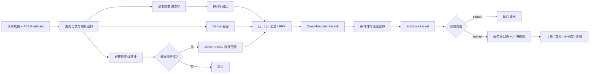

# esRAGPro 检索与证据编排设计

> 状态：已确认的实施基线  
> 文档版本：1.0  
> 依赖架构：`ARCHITECTURE.md`

## 1. 设计结论

旧的“L1→L2→L3→L4→L5”固定串行模型不再使用。BM25 和 dense 是互补的并行召回通道；图检索只在关系、路径、时态或冲突意图成立时触发；所有候选先融合、再由 cross-encoder 重排，最后形成可追溯 EvidencePacket。回答是证据包之上的可选步骤，不与检索结果混为一体。



核心不变量：

1. 所有召回分支在查询时使用服务端生成的 ACL 预过滤条件。
2. 原始问题始终保留；查询改写只能增加召回表达，不能替代或改变用户意图。
3. 图候选只能来自 publication_state=`active` 的权威 Claim，并且每条边有当前主体可见的证据。
4. RRF、reranker 分数是排序信号，不是事实置信度。
5. 无证据时返回 no-hit/拒答；不允许用模型常识填空。

## 2. 请求契约与有效策略

`kb.search_evidence` 和 `kb.answer_with_evidence` 共享以下领域请求。MCP 的 `inputSchema` 应进一步限制长度、枚举和数量。

```json
{
  "query": "报销审批为何需要部门负责人确认？",
  "knowledge_base_ids": ["uuidv7"],
  "filters": {
    "document_types": ["policy"],
    "tags": ["finance"],
    "valid_at": "2026-07-10T00:00:00Z"
  },
  "retrieval_profile": "auto|evidence|relationship",
  "graph_policy": "auto|never|required",
  "top_k": 8,
  "answer_mode": "evidence_only|server_answer",
  "budget_class": "interactive|analysis"
}
```

- 请求不包含 `tenant_id`、角色、组、clearance 或 ACL；这些只来自 PrincipalContext。
- `knowledge_base_ids`、过滤器、`top_k` 和预算请求只能缩小或降低服务端策略，不能扩大授权或超过硬上限。
- `valid_at` 用于文档和 Claim 的业务有效时间查询；缺省时采用服务端当前时间。事务时间由系统记录，不由客户端伪造。
- `graph_policy=required` 只表示调用者需要关系证据；没有合格图证据时返回明确状态，不自动编造路径。
- 服务端计算 `EffectiveRetrievalPolicy = min(tenant policy, principal grant, tool policy, request)`，并将策略版本写入 provenance。

## 3. 阶段一：授权、分类与查询准备

### 3.1 ACL 编译

在读取统计、实体词典或执行任何召回前，授权服务根据 PrincipalContext 生成 AccessPredicate。ES 两个通道共用相同 filter；Neo4j 使用相同租户、KB、文档版本、时态和 access partition 约束。实体链接词典也必须按租户和授权范围隔离。

请求完成后仍对证据 ID 做批量再授权，作为投影滞后和实现缺陷的纵深防御。若再授权移除了候选，则重新补位或降低状态，绝不能只删掉引用后保留答案句子。

### 3.2 查询分类

分类器可以由确定性规则、小模型或受约束 LLM 实现，输出以下可组合标签及校准分数：

| 标签 | 典型信号 | 主要作用 |
|---|---|---|
| `exact_fact` | 编号、错误码、产品名、精确短语 | 强化 BM25、标题和标识符字段 |
| `semantic` | 自然语言描述、同义表达 | 保持 dense 召回 |
| `relationship` | A 与 B 的关系、依赖、归属、影响 | 实体链接成功时触发图扩展 |
| `multi_hop` | 为什么、如何导致、经过哪些环节 | 触发有界路径搜索 |
| `comparison` | 差异、共同点、哪个适用 | 分别链接对象并强调来源多样性 |
| `temporal` | 某日期有效、最新、历史版本 | 加入 valid-time 与版本过滤 |
| `conflict` | 是否矛盾、哪个规定为准 | 检索支持与反驳证据，触发冲突 Claim |
| `aggregation` | 数量、分布、汇总 | 只使用授权后的结构化聚合，不让 LLM 猜统计 |

分类失败时采用安全基线：原始查询的 BM25+dense，不启用图路径，不执行生成式改写。

### 3.3 查询改写

改写按必要性触发，不是每个请求的固定步骤：

1. 进行 Unicode、空白、大小写和企业术语规范化，同时保留原始字符串用于引用和审计。
2. 对 exact intent 提取编号、专有名词、短语和可验证的别名；对中文保留原词与分词表达。
3. 仅从租户术语表、本体别名或受约束模型生成少量扩展；每个扩展记录来源。
4. 禁止加入问题未出现、词典无依据的实体、时间或断言；禁止让改写文本改变 ACL filter。
5. BM25 使用原始查询与词法扩展；dense 默认编码原始问题，可按模型规范添加检索指令，但不使用未经评测的自由生成答案作为查询。

### 3.4 实体链接

实体链接输出 `entity_id`、mention span、候选类型、别名命中、消歧证据和校准分数。候选仅来自当前租户和授权本体；同名实体不能仅凭字符串合并。低于领域阈值、存在多个近似候选或缺少类型约束时标记 ambiguous，图分支不自动执行；结果可返回消歧提示而不泄漏不可见实体。

## 4. 阶段二：并行召回

### 4.1 BM25 通道

- 检索字段包括标题、章节路径、正文、标识符、实体 mention 和受控标签；字段权重在版本化策略中配置。
- analyzer、同义词表、语言和停用词策略必须版本化。中文不能依赖空格分词，代码/编号字段使用不会破坏标识符的 analyzer。
- 原始查询和词法扩展可形成多个 rank list；不得把不可比较的原始分数直接相加。
- 时间、文档状态、版本和 ACL 均放在 filter context，不参与相关性打分。

### 4.2 Dense 通道

- 查询向量与索引必须使用相同 `embedding_model_id`、维度、归一化和 instruction profile。
- ANN 在授权 filter 内召回；若底层实现无法可靠进行预过滤，该实现不满足企业上线条件，不能以召回后过滤替代。
- dense 候选保留模型 ID、原始距离、rank 和投影 generation。距离只用于该通道排序，不直接解释为答案可信度。
- 嵌入服务失败时可降级为 BM25，并在结果中写 `DENSE_UNAVAILABLE`；不能提交空向量或伪造 dense 结果。

### 4.3 图通道触发条件

满足以下条件之一且实体链接质量达标时，`graph_policy=auto` 可触发图检索：

- 查询明确要求关系、依赖、上下游、归属、影响或因果链；
- 查询需要两跳及以上的路径、流程或影响分析；
- 比较两个已链接实体；
- 查询某时点的关系、规则冲突、替代或版本演化；
- 词法/dense 初召回出现多个已链接实体，且分类器判定关系证据能提高覆盖。

以下情况跳过：简单精确事实、实体链接 ambiguous、相关本体未启用、当前主体无可见 active Claim、图预算不足，或租户策略禁用图。调用者设置 `never` 时始终跳过；设置 `required` 而无法执行时返回 `graph_status=unavailable|no_match|ambiguous`。

### 4.4 图召回规则

- 只查询 `active` 且在 `valid_at` 有效的权威 Claim；ClaimCandidate 与 superseded/revoked/expired Claim 不进入普通检索。
- 遍历按 predicate allowlist、方向、最大跳数、最大路径数、每节点分支数和循环检测受限；这些上限来自 RetrievalBudgetPolicy。
- 路径每条边必须至少有一条当前主体可读 Evidence；不满足时该边在遍历前不可用。
- 图分数综合路径长度、predicate 策略、实体链接信号和证据质量，只用于图通道 rank。
- 图 Claim 映射到其支撑 evidence/chunk 后参与融合；路径本身作为单独结构返回，避免同一 Claim 的多条路径重复挤占文本候选。
- `inferred` 或候选关系只能用于离线审核，不能返回为已知事实。

## 5. 阶段三：融合、重排与多样性

### 5.1 候选归一化与去重

所有分支输出统一为：

```text
Candidate
  chunk_id, evidence_ids, channel, rank, raw_score,
  document_id, version_id, locator, projection_generation,
  graph_claim_ids, graph_path_ids
```

先按 `chunk_id` 合并同一块的多个通道命中，再按 Evidence span 合并重叠片段。相邻块可以在呈现时合并，但必须保留各自 locator 和 evidence_id。不同文档的相同文本不能简单去重掉，因为来源权威性和独立支撑数量具有意义。

### 5.2 RRF

```text
RRF(d) = Σ_channel weight(channel) / (rrf_k + rank_channel(d))
```

`rrf_k`、通道权重、每通道候选上限和图通道贡献上限全部属于版本化策略，由离线评测决定，不能写死为普适最佳值。缺失分支不贡献分数。RRF 使用 rank 解决 BM25、向量距离和图分数不可直接比较的问题。

为避免图路径或单一长文档支配结果：同一 Claim 的重复 evidence 先折叠，同一文档可进入重排的候选数受策略限制，同时保留至少一个 exact lexical 强命中。

### 5.3 Cross-Encoder Rerank

RRF 的前 N 个授权候选进入 cross-encoder，输入为原始问题、必要的查询意图和候选文本；N 由预算策略决定。reranker 输出相关性排序，不输出事实真值。

- 模型、tokenizer、截断策略和输入模板均记录版本。
- 表格、代码和长章节使用对应的序列化策略，避免只保留开头导致关键信息丢失。
- reranker 不可用时保留 RRF 顺序并返回降级 warning。
- 业务权威性、版本当前性、引用可定位性属于显式规则信号，不伪装为模型相关性；最终排序策略及其版本写入 provenance。

### 5.4 多样性与上下文预算

重排后按配置执行文档级上限、章节去重、近重复抑制和来源多样性。对于 comparison/conflict，必须尽量保留各对象或相反立场的证据；对于 exact_fact，优先精确命中而非为了多样性加入弱相关内容。

装包器按 token 预算选择证据，并保证：引用片段不截断到无法理解、表头随表格行携带、定义与被引用条款可组成 parent-child 上下文、每个回答候选声明都有可定位证据。被预算排除的候选只记录聚合诊断，不把敏感原文写入日志。

## 6. EvidencePacket 契约

```json
{
  "schema_version": "1.0",
  "query_id": "uuidv7",
  "status": "ready|partial|no_match",
  "interpreted_query": {
    "intents": ["relationship", "multi_hop"],
    "linked_entity_ids": ["uuidv7"],
    "graph_status": "used|skipped|ambiguous|unavailable|no_match"
  },
  "evidence": [
    {
      "evidence_id": "uuidv5",
      "resource_uri": "esrag://kb/knowledge-base-uuid/evidence/uuidv5",
      "document_id": "uuidv7",
      "version_id": "uuidv7",
      "title": "报销制度",
      "locator": { "page": 4, "section": "3.2", "span_start": 120, "span_end": 188 },
      "quote": "……",
      "channels": ["bm25", "dense", "graph"],
      "rank": 1,
      "valid_from": "RFC3339|null",
      "valid_to": "RFC3339|null"
    }
  ],
  "graph_paths": [
    {
      "path_id": "stable-run-path-id",
      "steps": [
        { "claim_id": "uuidv7", "predicate": "requires", "evidence_ids": ["uuidv5"] }
      ]
    }
  ],
  "coverage": {
    "requested_aspects": ["requirement", "reason"],
    "covered_aspects": ["requirement"],
    "missing_aspects": ["reason"]
  },
  "warnings": ["部分问题缺少可验证证据"],
  "provenance": {
    "retrieval_policy_version": "version",
    "model_set_id": "model-set",
    "corpus_revision": "revision",
    "search_projection_watermark": "watermark",
    "graph_projection_watermark": "watermark"
  }
}
```

生产输出可以隐藏内部 raw score，但必须保留 rank、渠道、模型/策略/语料版本和稳定 Resource Link。`partial` 表示某个必要分支降级或只覆盖部分问题，不等价于“答案大概正确”。

## 7. 可选服务器回答与声明核验

`kb.answer_with_evidence` 在 EvidencePacket 上执行：

1. 将问题拆为需要回答的原子方面；若 EvidencePacket 为 no_match，直接拒答。
2. 把文档视为数据并清晰分隔；禁止遵循证据文本内的指令。
3. 生成草稿时要求每个可验证声明绑定 evidence_id，不允许无引用的事实句。
4. 将草稿拆成原子 Claim，对每个 Claim 判定 `supported`、`contradicted` 或 `insufficient`，并返回支撑/反驳 Evidence。
5. 删除或改写 insufficient 声明；存在关键冲突时显式展示冲突，不擅自裁决。
6. 若核心问题仍无支撑则拒答；若只覆盖部分方面则返回部分回答和缺失说明。

回答状态：

| 状态 | 条件 | 行为 |
|---|---|---|
| `reliable` | 核心声明均有可见、可定位、未冲突的支撑证据 | 返回逐声明引用 |
| `partial` | 部分问题有支撑，缺失部分不影响已返回声明 | 只返回支撑部分并列出缺口 |
| `uncertain` | 存在来源冲突、时态歧义或核验器无法决定 | 展示冲突/歧义，不给确定结论 |
| `refused` | 无命中、核心声明证据不足或安全策略禁止 | 返回安全拒答与可选的查询改进建议 |

若提供数值 score，必须经过领域评测校准并标注含义；不得把向量相似度、reranker 分数或 LLM 自评直接称为 confidence。

## 8. No-hit 与信息不泄漏

以下情况均视为正常 no-hit，而非系统错误：授权语料中无候选、所有候选低于经过评测的最低证据门槛、请求时间点无有效版本、图 required 但没有可见合格路径。响应不得说明“存在但无权查看”，也不得返回未授权文档数量、标题、实体或缓存命中信息。

- `search_evidence` 返回 `status=no_match`、空 evidence 和不泄漏的建议。
- `answer_with_evidence` 返回 `status=refused`，不调用或不采纳自由回答。
- 查询拼写或实体 ambiguous 时可建议用户澄清，但只展示授权范围内的候选。
- 投影尚未就绪是 `PROJECTION_NOT_READY` 或带水位的 partial，不伪装成 no-hit。

## 9. 分块与索引策略

### 9.1 结构感知分块

不采用全局固定“500 字 + 50 字重叠”。分块器按文档类型和目标模型 token 窗口使用版本化 profile：

- 优先沿标题、段落、列表、条款、表格、代码块和页面布局边界切分。
- 维护 parent section 与 child chunk；检索 child，装包时可补充授权后的 parent 上下文。
- 重叠以完整句子/条款为边界，避免固定字符截断；每个字符只对应可复现的 normalized span。
- 表格尽量保持表头、行和注释原子性；跨页表重复必要表头并保留页码。
- 代码按符号/函数/类边界处理，保留文件、符号和行号 locator。
- OCR 文本保留页框、阅读顺序和 OCR quality；低质量片段降权或进入复核，不静默改写原文。
- 超长章节使用层级摘要仅辅助导航；摘要不能替代原文 Evidence，也不能成为 Claim 的唯一证据。

### 9.2 可复现性与去重

每个 Chunk 记录 `parser_version`、`normalizer_version`、`chunker_profile_version`、内容哈希和 locator。相同 DocumentVersion 与 profile 重跑必须得到相同 chunk/evidence ID。解析器或分块器升级创建新 projection generation，不原地覆盖旧 generation。

源文件 SHA-256 用于幂等摄取；近重复检测用于降低重复召回，但不同文档和不同版本仍保留独立来源。仅当前 active 版本默认参与检索，历史查询显式指定 `valid_at` 或版本。

## 10. 模型与索引版本迁移

`ModelSet` 至少包含：embedding model、维度、归一化/instruction、BM25 analyzer/synonym set、cross-encoder、实体链接器、本体、parser 与 chunker profile 的版本和制品哈希。

迁移流程：

1. 为新 ModelSet 创建独立 ES index generation 和模型注册记录；不同维度/模型的向量不得混入同一字段。
2. 新写入双投影到当前与候选 generation，历史 active 版本后台回填；每次写入幂等并可断点续跑。
3. 影子查询分别对旧、新 generation 编码和检索，比较质量、权限、资源与延迟；不把未经门禁的新结果直接返回用户。
4. Reconciler 确认所有 active 版本完成、无孤儿投影，离线评测和 ACL 门禁通过后，原子切换读别名/ModelSet。
5. 响应记录实际 ModelSet 与 generation；出现回归时原子回滚读别名。旧 generation 按保留策略延后清理。
6. reranker、analyzer、本体或分块器变化同样触发策略/投影版本，禁止只改配置而无法复现旧结果。

## 11. 检索预算与降级

每个租户必须配置并在启动时验证 `RetrievalBudgetPolicy`，至少包含：

```text
request_deadline
lexical_candidate_limit
dense_candidate_limit
fusion_candidate_limit
rerank_candidate_limit
graph_max_hops / graph_max_paths / graph_branch_limit
evidence_item_limit / evidence_token_limit
rewrite_call_limit / answer_call_limit / verification_call_limit
model_token_limit / monetary_cost_ceiling
per_stage_deadline_and_concurrency
```

`interactive` 与 `analysis` 只是引用不同的服务端策略，不承诺通用固定毫秒数。有效预算取租户、主体、Tool 和请求的最严格值；deadline 向各分支传递，禁止超时后继续后台消耗资源。

降级顺序：

| 故障或耗尽 | 行为 |
|---|---|
| 分类/改写失败 | 原始查询 BM25+dense |
| embedding 失败 | BM25-only，标记 partial |
| BM25 分支失败 | dense-only，标记 partial |
| 图不可用 | auto 模式跳过并警告；required 返回明确不可用 |
| reranker 不可用 | 使用 RRF 顺序并警告 |
| 回答模型不可用 | 返回 EvidencePacket，不丢失检索结果 |
| 授权服务/Predicate 编译失败 | fail closed，不执行召回 |
| 删除屏障或具体证据再授权失败 | 移除相关结果并重新判定，绝不返回缓存内容 |
| 预算耗尽 | 停止后续昂贵阶段，返回 partial 或拒答及耗尽阶段 |

缓存键必须包含 tenant、授权 fingerprint、规范化查询、过滤器、valid_at、RetrievalPolicy、ModelSet、corpus revision 和 projection watermark。ACL 或版本变化使相关缓存失效；不得跨不同授权 fingerprint 共享正文结果。

## 12. 评测体系与发布门禁

### 12.1 评测集

评测样本按租户隔离并版本化，覆盖 exact、semantic、关系、多跳、比较、时态、冲突、no-hit、OCR/表格/代码、多语言、提示词注入和权限负例。每个样本包含允许的主体、时间点、相关 document/version/evidence、可接受 Claim、反驳证据和预期回答/拒答状态。

权限评测必须包含：跨租户同名文档、被撤销 ACL、组变更、缓存复用、签名 cursor 重放、删除传播窗口、图边含不可见证据、Resource URI 猜测。

### 12.2 指标

| 层面 | 指标 |
|---|---|
| 召回 | Recall@k、Precision@k、MRR、nDCG@k，分别统计 BM25/dense/融合/重排 |
| 实体与图 | entity linking accuracy/F1、graph path precision/recall、每边 evidence coverage、时态正确率 |
| 证据 | citation precision/recall、locator 可解析率、来源多样性、重复率、核心方面覆盖率 |
| Claim 核验 | supported/contradicted/insufficient 的 macro-F1、冲突识别率 |
| 回答 | grounded claim ratio、答案正确性、引用归属、拒答 precision/recall、部分回答准确性 |
| 安全 | 未授权 evidence/metadata 泄漏数、注入成功数、跨租户缓存命中数；发布门禁均为零 |
| 系统 | 分阶段 p50/p95/p99 实测延迟、超时/降级率、预算超限率、成本、投影新鲜度 |

向量相似度或主观 LLM judge 不能单独作为质量证明。高风险领域需要人工标注集和抽样复核；judge 的模型、Prompt 和版本必须固定并校准。

### 12.3 验收规则

- 安全门禁是绝对门禁：任何越权证据或存在性泄漏都阻止发布。
- 每个领域在发布配置中登记可追溯的最低检索、引用、核验和拒答阈值；阈值来自其标注集与风险等级，不使用未经数据支持的统一数字。
- 新 ModelSet/策略必须对当前生产基线做成对比较，关键切片不得显著回退；统计方法、样本版本和结果随发布归档。
- 性能指标只在目标硬件、真实语料规模、并发与权限过滤条件下报告，形成容量曲线，不把开发机结果写成产品承诺。

线上只收集经治理的查询类别、状态、引用点击、no-hit、降级和人工纠正信号；敏感正文和完整查询默认不进入分析系统。线上信号用于发现漂移，不能替代离线标注评测。

## 13. 可观测与审计字段

每次检索至少记录：request/trace/query ID、tenant、主体的不可逆标识、tool、策略与 ModelSet、授权 fingerprint、各分支是否运行及耗时/候选数、融合/重排数量、图状态、Evidence 数量、no-hit/partial/refused 原因、预算消耗、corpus revision 和投影水位。正文、quote、token、完整 ACL 与模型敏感输入按数据分类策略脱敏或不记录。

这些字段使一次结果可复现、可解释、可比较，同时不把“检索过程透明”误解为泄露内部文档或安全策略。
